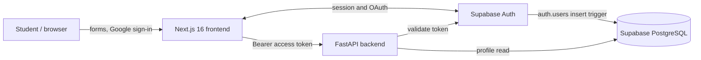
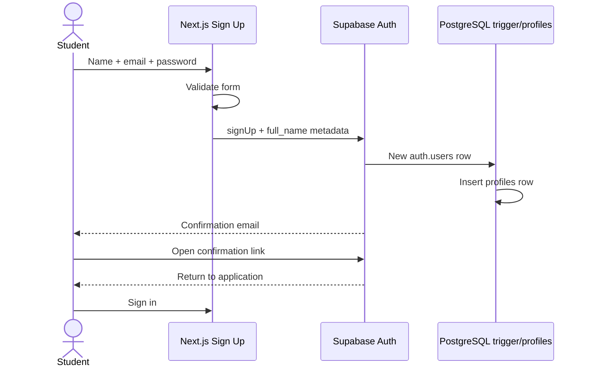
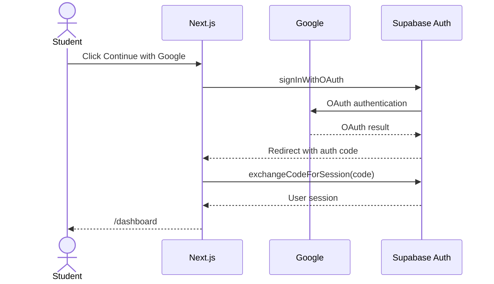
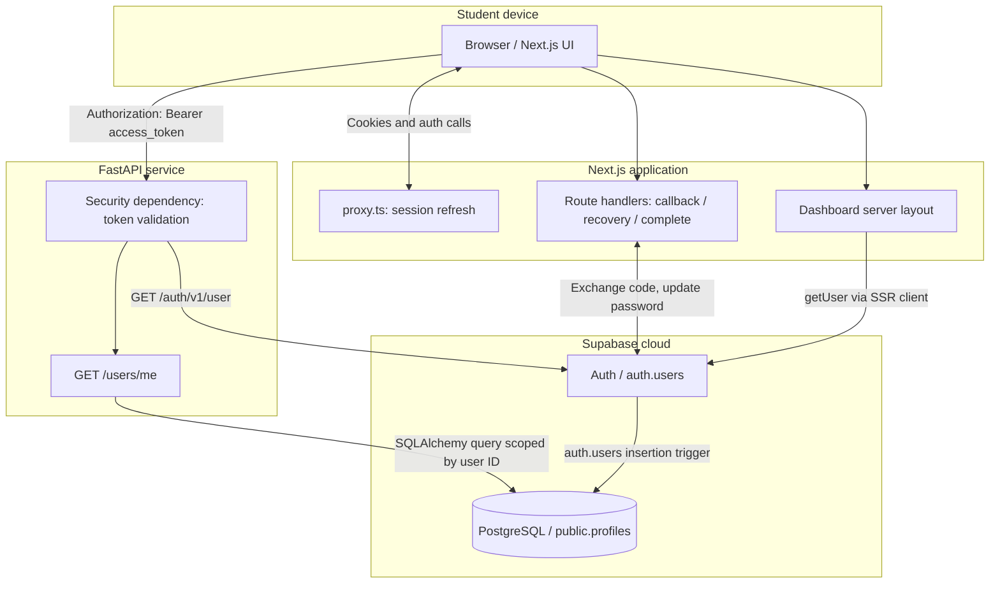
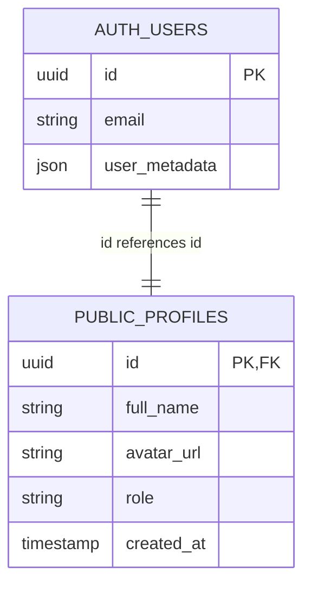
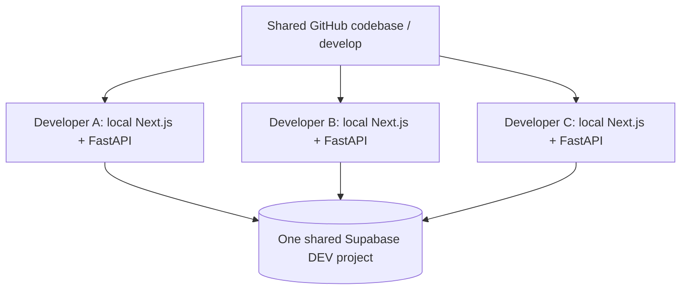

# YA DOC — Feature 01 Complete Documentation (Single-file edition)

**Version:** 2026-10-09 · **Format:** GitHub-flavored Markdown · **Status:** Local-development V1 accepted, production audit pending

> This is a combined reading edition. Use the modular ZIP for repository integration; relative links in copied sections refer to the modular package.


---


# Feature 01 — Authentication & User Management

> **Project:** YA DOC (يادوك) — AI-powered clinical simulation for medical students
> **Document status:** V1 implementation handoff / local development acceptance
> **Last reviewed:** 2026-10-09
> **Primary audience:** New teammates, reviewers, maintainers, supervisors, and future contributors
> **Scope:** User registration, authentication, account recovery, persisted user profiles, and authenticated application access.

## Read this first (even if you are new to programming)

**Authentication** answers *“Who is the user?”* and prevents someone else from using their account. **User management** associates that identity with application-specific information, such as a displayed name or role. In YA DOC, students can create an account, confirm an email address, log in with email/password or Google, access a protected dashboard, log out, and reset a forgotten password.

We deliberately did **not** build our own password database: **Supabase Auth** handles the identity/password infrastructure. **Next.js** presents the screens and stores the authentication session using the Supabase SSR integration; **FastAPI** verifies access tokens before exposing protected backend endpoints; **PostgreSQL** stores each user's application profile.

**What V1 means:** The primary flows were exercised successfully during development and the latest reported frontend build and backend tests passed. This is **not** a claim of public-production security readiness or completed cross-device QA. See [Security & Known Limitations](07-security-and-limitations.md).

## Documents and reading order

| File | What you will learn | Recommended for |
|---|---|---|
| [01 — Product & functional requirements](01-product-and-flows.md) | Capabilities, user stories, every journey and edge case | Anyone, including non-technical readers |
| [02 — System architecture](02-architecture.md) | What runs where, trust boundaries, SSR, session lifetime, data flow | Frontend/backend developers |
| [03 — Implementation and code map](03-code-walkthrough.md) | File responsibilities, how the logic is implemented and extended | Developers/new maintainers |
| [04 — API & database](04-api-and-database.md) | Backend endpoints, profile model, trigger, RLS, migration history | Backend/database developers |
| [05 — Local setup & configuration](05-setup-and-configuration.md) | Prerequisites, environment files, service configuration, how to run | Anyone onboarding |
| [06 — Tests & acceptance](06-testing-and-acceptance.md) | Evidence, commands, manual cases, what was and wasn't tested | QA/reviewer/team lead |
| [07 — Security & limitations](07-security-and-limitations.md) | Threats, decisions, technical debt and production blockers | Reviewer/tech lead |
| [08 — Troubleshooting & decisions](08-troubleshooting-and-decisions.md) | Actual issues encountered, fixes, lessons learned | All contributors |
| [09 — Team handoff & next steps](09-team-handoff.md) | Shared Supabase workflow, ownership, checklists, release gate | Whole team |
| [Arabic guide / الدليل العربي](README.ar.md) | Simple Arabic orientation and technical glossary | Arabic-speaking newcomers |

## Scope, explicitly

### Included in Feature 01

- Google OAuth sign-in through Supabase.
- Email/password registration with full name, password confirmation and input validation.
- Email confirmation using Supabase Auth.
- Email/password sign-in and informative errors.
- Password visibility controls; loading and error states.
- Password reset email request, recovery-code exchange, new-password form, and sign-out after a successful reset.
- Protected dashboard access and basic user information display.
- Logout.
- Backend protected user-profile endpoint.
- PostgreSQL `public.profiles` table; trigger-based creation for new Supabase Auth users; Alembic migration history.
- Basic automated backend tests and successfully completed Next.js production build.

### Not in Feature 01

- Medical case storage, case browsing, simulation sessions, clinical AI chat, progress analytics, and scoring.
- Final, approved UI/UX redesign. A separate design brief exists, but was explicitly deferred.
- Production deployment, custom domain, and transactional-email provider setup.
- Dedicated production database, full production security hardening or comprehensive device/browser coverage.
- Git commit, push, pull request or merge (these had **not** been performed as part of this handoff).

## A quick system map



## What was verified during this project

| Verification | Reported outcome | Evidence type |
|---|---|---|
| Google OAuth login and dashboard navigation | Successful | Local browser manual test |
| Email/password registration and email confirmation | Successful | Email received + successful subsequent login |
| Email/password login and logout | Successful | Manual test |
| Password reset end-to-end (new password accepted; old rejected) | Successful | User-confirmed manual test |
| Opening reset page without valid recovery | Reset form unavailable | Screenshot/manual test |
| Next.js production build, TypeScript, route generation | Successful | `npm run build` terminal output, 2026-10-09 |
| FastAPI automated tests | **4 passed, 1 third-party deprecation warning** | `pytest -q` output, 2026-10-09 |
| Mobile use via `http://192.168.1.26:3000` | **Not working reliably** | Local dev-origin problem; intentionally deferred |
| Production security and email delivery | **Not validated** | Outside V1 scope |

## Working agreements

- The **running source code is authoritative**. These documents are based on code excerpts, test logs and decisions shared during implementation, **not** a fresh end-to-end checkout of the repository. Where a precise file, schema or setting was not directly inspected, that limitation is stated.
- Never commit `.env` or `.env.local`. Example files must have **empty secret values**.
- Do not place Supabase service-role keys, PostgreSQL passwords or private API keys in `NEXT_PUBLIC_*` variables.
- Do not edit production-like shared database tables manually. Use reviewed Alembic migrations; see [Team Handoff](09-team-handoff.md).
- The frontend dashboard guard is **not** authorization for backend endpoints; each protected endpoint must verify its own token and permissions.

## Definition of done for this handoff

**Accepted for V1 local/team development:** Core auth flows + recovery worked in reported manual testing, frontend production build succeeded, backend tests passed.
**Still needed for public launch:** Security review of recovery implementation, production SMTP, least-privilege DB access, deployment/HTTPS, complete mobile/browser regression and broader test coverage. A green build does not close those tasks.

---
**Maintenance rule:** Update this document and the relevant detailed page whenever an auth route, DB model, redirect URL, error policy or security assumption changes.


---


# الدليل العربي المبسّط — Feature 01: Authentication & User Management

[English technical documentation](README.md)

> **حالة الفيتشر:** نسخة V1 شغالة في بيئة التطوير واتجربت، لكن **مش جاهزة للإطلاق العام** قبل مراجعات الأمان والإيميلات والموبايل.
> **آخر تحديث:** 9 أكتوبر 2026.

## المشروع ده بيعمل إيه أصلًا؟

**يادوك** منصة تدريب طبي بالذكاء الاصطناعي. قبل ما الطالب يبدأ يختار حالة طبية أو يتكلم مع المريض الافتراضي، لازم يبقى له حساب آمن يقدر يرجع له. أول Feature مسؤولة عن إنشاء الحساب والدخول والخروج واسترجاع كلمة المرور، وكمان معرفة الطالب الحالي وتخزين بيانات ملفه الشخصي.

## القصة من أولها لآخرها

1. **الطالب الجديد** يفتح صفحة التسجيل `/sign-up`، ويكتب الاسم والإيميل والباسورد وتأكيدها.
2. **Supabase Auth** ينشئ حساب الهوية ويبعت إيميل تأكيد لو خاصية التأكيد مفعّلة.
3. لما الطالب يفتح رابط التأكيد، يقدر يرجع يسجّل دخول.
4. بدل الباسورد، يقدر يدخل باستخدام **Google**.
5. بعد الدخول، **Next.js** يتحقق إن فيه مستخدم حقيقي ويسمح له يفتح `/dashboard`.
6. الـ **Backend (FastAPI)** يقدر يتحقق من الـ Access Token، ويجيب Profile الطالب من PostgreSQL لما يطلب بيانات محمية.
7. لو نسي الباسورد، يطلب رسالة استرجاع، يفتح الرابط، يعيّن باسورد جديد، ويسجّل دخول من جديد.

## استخدمنا إيه وليه؟

| التقنية | بتعمل إيه عندنا؟ | ليه اخترناها؟ |
|---|---|---|
| Next.js + React | صفحات الدخول والتسجيل والداشبورد | تطبيق ويب منظم وقابل للتوسع |
| Supabase Auth | تسجيل الحسابات والباسورد وجوجل والتأكيد | بدل ما نخزن باسوردات أو نبني Auth من الصفر |
| FastAPI | الـ API الخاص بالمشروع والتحقق من هوية اللي بيطلبه | مناسب لتيم Python/AI |
| Supabase PostgreSQL | بيخزن معلومات الطالب الخاصة بالتطبيق | Database موحّدة للأعضاء |
| SQLAlchemy | بيربط كود Python بجداول PostgreSQL | طريقة منظمة للتعامل مع البيانات |
| Alembic | بيتابع أي تغيير في الجداول مع الوقت | عشان الفريق يعمل Integration من غير تضارب |

## الفرق بين Supabase Auth و`profiles`

**Supabase Auth** مسؤول عن «مين الطالب وبيسجّل دخول إزاي؟» وبيحتفظ ببيانات الحسابات بأمان عند مزوّد الهوية.

جدول **`public.profiles`** مسؤول عن «بيانات الطالب جوّه يادوك»، وفيه الـ ID والاسم والصورة والـ Role وتاريخ الإنشاء. كل Profile مرتبط بنفس الـ UUID الموجود في `auth.users`.

**معلومة مهمة:** لما طالب جديد يسجّل، Trigger في PostgreSQL بيعمل له Profile تلقائيًا. ده اتنفذ عن طريق Alembic Migration، مش كل مرة نكتب INSERT من الفرونت.

## الـ Routes الأساسية

| اللينك | وظيفته |
|---|---|
| `/` | تسجيل الدخول |
| `/sign-up` | إنشاء حساب |
| `/auth/callback` | استقبال رد Google بعد تسجيل الدخول |
| `/forgot-password` | طلب رسالة استرجاع |
| `/auth/recovery` | التأكد من كود الاسترجاع |
| `/reset-password` | إدخال الباسورد الجديد |
| `/reset-password/complete` | Endpoint بتنّفذ التغيير على السيرفر |
| `/dashboard` | صفحة محمية للمستخدم المسجل |

## إزاي الحماية شغالة؟

- الـ Dashboard بيعمل Check على المستخدم من Supabase ناحية السيرفر.
- الـ Backend مش بيثق في رقم مستخدم يبعته الفرونت؛ بيتحقق من الـ Bearer Token ويربطه بالـ UUID الحقيقي.
- تسجيل الخروج بينهي جلسة التطبيق الحالية.
- مش بنخزن الباسورد في جدول `profiles`.
- **لسه فيه مراجعة أمنية مطلوبة قبل الإطلاق:** الـ Recovery Cookie غير موقعة، والصلاحيات الفعلية لاتصال PostgreSQL لازم تتراجع؛ مينفعش نقول إن الفيتشر جاهزة أمانياً للإطلاق على الناس كلها.

## اختبرنا إيه بجد؟

**نجح فعلًا حسب التجارب اللي اتعملت:** Google Login، Email Sign Up، تأكيد الإيميل، Email Login، الـ Logout، حماية Dashboard، فتح رابط استرجاع الباسورد، تغيير الباسورد، قبول الجديد ورفض القديم.

**الاختبارات البرمجية:** آخر `npm run build` نجح، و`pytest` نجح **4 من 4** (مع Warning واحدة من مكتبة خارجية).

**لسه:** اختبار الموبايل على رابط HTTPS حقيقي، مراجعة الأمان، SMTP مخصص، واختبارات E2E آلية موسعة. لما جربنا الـ Local IP ظهرت مشكلة Next.js بتمنع ملفات Dev معينة، ودي ركنّاها لتجربة HTTPS لاحقًا.

## تشغّل يادوك على جهازك إزاي؟

بعد ما تعمل Clone للريبو:

```powershell
# من جذر المشروع
Copy-Item .env.example .env
Copy-Item frontend\.env.example frontend\.env.local
```

املا قيم الإعدادات من القناة الآمنة المعتمدة في التيم، **مش من GitHub**. بعدين افتح Terminal للـ Backend:

```powershell
cd backend
py -3.13 -m venv .venv
.\.venv\Scripts\python.exe -m pip install -r requirements.txt
.\.venv\Scripts\python.exe -m uvicorn app.main:app --reload
```

وفي Terminal تاني للـ Frontend:

```powershell
cd frontend
npm ci
npm run dev
```

الواجهة: `http://localhost:3000`
الـ Backend Docs: `http://127.0.0.1:8000/docs`

## كل التيم هيشتغل على نفس الداتا بيز إزاي؟

- كل واحد يشغّل Next.js وFastAPI **محليًا عنده**.
- الكل يوصل لنفس **Supabase Project** المشترك.
- لو هتضيف جدول جديد، اكتب **Alembic Migration** ومتعدّلش الجدول يدويًا.
- عضو تاني يراجع الـ Migration، وعضو واحد متفق عليه يطبّقها مرة واحدة على قاعدة التطوير المشتركة.
- **مش لازم التيم ليدر يوافق على كل تفصيلة**؛ دوره يراجع التوافق النهائي بين الـ Features.

## مصطلحات بسرعة

- **Authentication:** إثبات مين اللي بيسجّل دخول.
- **Authorization:** هل المستخدم ده مسموح له يشوف/يعدّل الحاجة دي؟
- **Token:** تصريح رقمي مؤقت يثبت الهوية للـ API.
- **Session:** حالة إن المستخدم مسجّل دخول.
- **OAuth:** تسجيل دخول من خلال مزوّد زي Google.
- **SSR:** السيرفر يقدر يعرف حالة المستخدم من الكوكيز ويعمل Guard للصفحات.
- **PKCE:** طريقة آمنة لإكمال بعض تسجيلات الدخول/الاسترجاع بتبادل كود مؤقت.
- **Migration:** ملف تاريخي بيتسجل فيه تغيير هيكل الداتا بيز.
- **RLS:** قواعد على مستوى PostgreSQL تتحكم مين يقرأ/يكتب الصفوف؛ تفعيلها لوحده مش كفاية بدون فهم صلاحيات الاتصال.
- **Endpoint:** عنوان ووظيفة في الـ API.
- **Build:** تجهيز نسخة إنتاجية من الفرونت واكتشاف أخطاء Compilation/TypeScript.

## فين باقي التفاصيل؟

لو عايز التفاصيل الفنية «فتفوته»، افتح [الفهرس الرئيسي بالإنجليزي](README.md). هتلاقي ملفات مستقلة لكل Flow، شرح كل ملف كود، الـ Architecture، الـ Database، الـ API، المشاكل وحلولها، الاختبارات والأمان وتوجيهات التيم.


---


# 01 — Product requirements and user journeys

[← Documentation index](README.md)

## 1. Why this feature exists

YA DOC is an educational platform where a medical student must be able to return to their own training space. Before offering cases and simulation history, the app needs a dependable identity system. This feature supplies it.

**Audience:** Primarily Egyptian medical students; RTL Arabic-first forms are part of the product experience. The current V1 is usable for local development and demos; the visual redesign is separately planned.

## 2. Vocabulary for beginners

| Term | Plain-language meaning | YA DOC implementation |
|---|---|---|
| Sign up | Create an account | Email/password or Google via Supabase Auth |
| Sign in / Login | Prove you own the account | Password check or Google OAuth |
| OAuth | Log in with an existing trusted identity provider | Google redirects via Supabase, then back to YA DOC |
| Session | Proof that you are logged in for a period of time | Supabase auth tokens/session handled by `@supabase/ssr` |
| Access token | Credential used to access protected APIs | Bearer token validated by backend |
| Email confirmation | Verify access to the email address | Supabase verification email |
| Recovery | Regain access without the old password | Recovery email + code exchange + new password |
| Profile | App-specific information tied to the identity | Row in `public.profiles` |
| Redirect | Send the browser to another URL | Login → dashboard; logout → sign-in |
| RLS | Database-level row access control | Enabled for `public.profiles`; policies not defined in inspected state |

## 3. User-facing surfaces

| Frontend URL | Purpose | Access expectation |
|---|---|---|
| `/` | Email/password and Google login | Guests; authenticated users redirect to dashboard |
| `/sign-up` | Account creation | Guests; authenticated users redirect to dashboard |
| `/auth/callback` | Server callback for Google OAuth | Only valid auth-code callback |
| `/forgot-password` | Request reset email | Public form |
| `/auth/recovery` | Exchange recovery authorization code | Only valid recovery-code callback |
| `/reset-password` | Set a new password | Recovery marker + valid Supabase user/session checked |
| `/reset-password/complete` | Server-side password update | Authenticated POST with recovery marker |
| `/dashboard` | Protected student application area | Logged-in users only |

**Note:** `/auth/callback` and `/auth/recovery` are **technical routes**, not normal pages students browse directly.

## 4. User story A — Register with email/password

**As a new student**, I want to create an account so I can enter YA DOC later.

1. Navigate to `/sign-up`.
2. Fill in full name, email, password, confirmation.
3. Frontend checks nonempty inputs; name ≥ 2 characters; password ≥ 8 characters; confirmation matches.
4. Frontend calls `supabase.auth.signUp({ email, password, options: { data: { full_name }, emailRedirectTo } })`.
5. Supabase Auth creates the auth identity (subject to provider settings and confirmation).
6. A PostgreSQL trigger associated with `auth.users` creates/synchronizes the corresponding application profile in `public.profiles`.
7. When email confirmation is required, the user sees a check-email message, receives a verification email and opens its link.
8. The user returns to YA DOC and signs in. A **successful sign-in**, not simply landing on `/`, was used to confirm verification worked.



**Edge conditions:** Wrong confirmation blocks the request; weak password and rate limits show user-readable errors; no sensitive backend details are displayed. A signed-up but unconfirmed user may be unable to sign in until confirmed, depending on Supabase settings.

## 5. User story B — Login with email/password

1. Open `/`.
2. Enter email and password (the email field is left-to-right).
3. Click Sign In. The button displays a loading state to reduce duplicate requests.
4. `supabase.auth.signInWithPassword` validates the credentials.
5. Successful session → Next.js router navigates to `/dashboard`.
6. Dashboard server layout calls Supabase `getUser()`; absent/invalid user → redirect to `/`.
7. Dashboard shows name and email.

**Negative cases:** Wrong password, nonexistent/unconfirmed account or temporary network failure must be handled with appropriate messages. The exact error mapping should be checked against the currently committed `sign-in-form.tsx`.

## 6. User story C — Login with Google

1. Click the Google button on `/` or `/sign-up`.
2. Supabase browser client starts `signInWithOAuth({ provider: "google", options: { redirectTo: origin + "/auth/callback" } })`.
3. The user authenticates with Google through the configured Supabase provider.
4. The browser returns to `/auth/callback?code=…`.
5. The server callback calls `exchangeCodeForSession(code)`.
6. Successful exchange → `/dashboard`; failed exchange → controlled error response.
7. If it is a new identity, the DB trigger populates its profile.



**Do not confuse** the Google developer-console callback to Supabase with the app-level callback `/auth/callback`; they are different redirect steps.

## 7. User story D — Forgot and reset password

1. Open `/forgot-password` and submit email.
2. Frontend calls `resetPasswordForEmail(email, { redirectTo: origin + "/auth/recovery" })`.
3. UI shows a generic check-email success message without disclosing whether the email exists.
4. If Supabase sends a recovery email, the user opens its link in the same browser context used to initiate the PKCE request.
5. `/auth/recovery` receives `code` and optional `sb_flow_id`, calls `exchangeCodeForSession`, then redirects to `/reset-password`.
6. Callback sets a short-lived, HttpOnly `yadok-recovery` cookie associated with the exchanged user ID; the current implementation uses it as a **UI/route gate**.
7. Reset page checks the marker and `supabase.auth.getUser()` before rendering the form.
8. The user enters and confirms a new password.
9. Form POSTs `{ password }` to `/reset-password/complete`.
10. Server rechecks the authenticated user and marker, calls Supabase `updateUser({ password })`, attempts `signOut`, and deletes the recovery marker after successful update.
11. User returns to login and signs in with the new password.

```mermaid
sequenceDiagram
    actor U as Student
    participant UI as Forgot Password
    participant S as Supabase Auth
    participant R as Recovery Callback
    participant C as Reset Completion API
    U->>UI: Submit email
    UI->>S: resetPasswordForEmail
    S-->>U: Email with recovery link
    U->>R: Open link containing code
    R->>S: exchangeCodeForSession
    R-->>U: Session + temporary recovery marker
    U->>C: POST new password
    C->>S: getUser then updateUser
    C->>S: signOut (attempt)
    C-->>U: Success response; marker expired
    U->>UI: Sign in with new password
```

**Observed manual result:** New password worked, previous password was rejected, and reopening the reset page without a valid recovery context did not reveal the form.

**Security caveat:** The marker contains an unsigned user ID; it is *not* independent cryptographic proof of a recovery email. See [Security & Limitations](07-security-and-limitations.md).

## 8. User story E — Logout and protect the dashboard

- Logout uses the existing `LogoutButton` and Supabase client sign-out logic. After logout, protected routes should redirect the browser back to `/`.
- `frontend/app/dashboard/layout.tsx` performs a **server-side** user lookup; it does not rely on a client-only variable saying "logged in".
- All backend routes handling protected data must independently validate the user's access token; successful rendering of the dashboard cannot substitute for API authorization.

## 9. UX currently present versus intentionally deferred

**Present:** RTL Arabic interface, logo, styled login/signup/forgot/reset screens, password visibility toggles, basic error/loading/success states, reusable `AuthShell`, Google login button, responsive dashboard shell.
**Deferred:** Premium Linear-inspired redesign, full mobile usability validation, accessibility audit against WCAG 2.2 AA, final polished dashboard and product onboarding.

## 10. Acceptance criteria

A journey passes only when the actual behavior occurs: confirmation email **arrives and verifies**; auth succeeds; protected page opens only with valid session; logout revokes the browser session; password update succeeds and old password no longer authenticates. Merely rendering a page or compiling code is not sufficient evidence.


---


# 02 — Architecture and trust boundaries

[← Documentation index](README.md)

## 1. Main components

| Layer | Technology | Responsibility | Runs where |
|---|---|---|---|
| Web UI | Next.js **16.4.0**, React **19**, TypeScript, Tailwind CSS **4** | Forms, navigation, protected dashboard | Local Next.js; Vercel deployment planned, not verified |
| Browser auth SDK | `@supabase/ssr` / Supabase JS | Login/signup/OAuth/reset requests, cookie-compatible session | Browser + Next.js SSR |
| Next.js server | App Router, Route Handlers, `proxy.ts` | Auth callbacks, session refresh, server-side route guards and reset completion | Next.js runtime |
| Backend API | FastAPI, Python **3.13**, Pydantic | API contracts, bearer-token verification, user-profile endpoint | Local Python service; Railway planned, not deployed |
| ORM/migrations | SQLAlchemy, psycopg, Alembic | Profile queries, schema evolution | Backend process / migration command |
| Identity provider | Supabase Auth | Password hashes, email confirmation, Google OAuth, tokens | Supabase managed cloud |
| App DB | Supabase-hosted PostgreSQL | `public.profiles` and future application data | Supabase managed cloud |

The **identity record** in `auth.users` and the **application record** in `public.profiles` serve different purposes and should not be conflated.

## 2. Deployment/runtime boundaries



### Security boundary A — Web browser

The browser can access `NEXT_PUBLIC_SUPABASE_URL` and `NEXT_PUBLIC_SUPABASE_PUBLISHABLE_KEY`. These are public client configuration values, **not** privileged database credentials. Password values should go to the authentication provider, not a custom `password` field in `public.profiles`.

### Security boundary B — Next.js server

`createServerClient` in `frontend/lib/supabase/server.ts` uses Next.js request cookies. `frontend/proxy.ts` refreshes Supabase session information (reported to use `auth.getClaims()` in the established implementation). Google and recovery callbacks exchange authorization codes server-side, avoiding app-written password authentication.

### Security boundary C — FastAPI API

The FastAPI protected route uses a dependency `get_current_user`. The known implementation makes an authenticated request to Supabase Auth `/auth/v1/user` to validate an access token. After validation, `/users/me` uses the validated UUID to locate the user's profile in PostgreSQL. **Never trust a UUID supplied by an unauthenticated request body or query string.**

### Security boundary D — Database

The SQLAlchemy engine uses `settings.database_url` over SSL (`sslmode=require`) with `pool_pre_ping=True`. It is a **direct PostgreSQL connection**. A direct SQL connection does not automatically impersonate the logged-in Supabase Auth user for `auth.uid()` in RLS policies. Application-level filtering and database role privileges must both be considered.

## 3. Server rendering and protected routes

Authentication state depends on the incoming user's cookies. Because the project uses Next.js Cache Components and Partial Prefetching, treating this data as static prerender content caused a `Blocking Route` error in development.

The implemented protected layout contains the following **relevant structure**:

```tsx
export const instant = false;

export default async function DashboardLayout({ children }) {
  await connection();
  const supabase = await createClient();
  const { data: { user }, error } = await supabase.auth.getUser();
  if (error || !user) redirect("/");
  // ... render shared dashboard shell
}
```

The dashboard **page** was also updated to export `instant = false` in this project's Next.js version. The final reported `npm run build` passed and `/dashboard` was emitted as a dynamic route (`ƒ`). This describes the observed implementation, not a recommendation to disable Cache Components globally. For a future refactor, follow the current Next.js guidance on Suspense/streaming and dynamic data.

## 4. Who owns what?

| Question | Source of truth |
|---|---|
| Is this email/password correct? | Supabase Auth |
| Is the Google account authorized? | Google via Supabase Auth |
| Which user is signed in? | Supabase authenticated user/session |
| Which app profile belongs to the user? | `profiles.id`, tied to `auth.users.id` |
| What is this user's current app role? | Database `profiles.role`, not editable client metadata |
| May a backend endpoint return protected data? | Backend token validation + per-resource authorization |
| Which tables/columns exist? | Versioned Alembic migrations + database state |

## 5. Session/cookie handling

- Supabase's SSR client uses cookies so the server can check the session on navigation.
- Login/sign-up activities use the browser client.
- `/auth/callback` uses `exchangeCodeForSession` to complete Google OAuth.
- `/auth/recovery` uses `exchangeCodeForSession` for password recovery, and sets the temporary `yadok-recovery` **HttpOnly** cookie with a 15-minute age on the `/reset-password` path.
- `/reset-password/complete` rechecks the user, changes the password, attempts sign-out and expires the recovery cookie after successful update.
- The current marker's **unsigned** contents must not be treated as proof independent of the authenticated session; see security page.

## 6. Why this architecture was selected

- Supabase Auth avoids custom password storage and complex identity implementation.
- Next.js App Router supports polished UI, SSR cookies and route-level protection.
- FastAPI matches the team's Python/AI skills and will serve future simulation features.
- PostgreSQL supports profiles, clinical case metadata and future relational data.
- Alembic provides a reviewable, repeatable schema history.
- Hosting services (Vercel/Railway) were **plans**, not deployment evidence.

## 7. Future expansion points

The same authentication session should authorize future case listing, simulation, assessments and user progress APIs. Every new resource needs its **own authorization checks**. Do not reuse the temporary password-recovery cookie for any other endpoint or interpret a verified identity as authorization to edit all cases.

## References

- [Supabase: Server-Side Auth](https://supabase.com/docs/guides/auth/server-side)
- [Supabase JS: exchangeCodeForSession](https://supabase.com/docs/reference/javascript/auth-exchangecodeforsession)
- [Next.js: Cache Components](https://nextjs.org/docs/app/api-reference/config/next-config-js/cacheComponents)
- [Next.js: Blocking Route](https://nextjs.org/docs/messages/blocking-route)


---


# 03 — Source-code walkthrough

[← Documentation index](README.md)

> **Important accuracy note:** Paths below reflect the files and code discussed and/or pasted during implementation. They were not verified by an independent repository checkout for this documentation pass. Read the current files before editing. Do not copy example snippets blindly over newer implementations.

## 1. Repository organization

```text

yadok-ai/
├── .env                    # local secrets; never commit
├── .env.example            # safe environment variable template
├── frontend/
│   ├── .env.local          # local frontend config; never commit
│   ├── .env.example
│   ├── next.config.ts
│   ├── proxy.ts
│   ├── public/brand/yadok-logo.png
│   ├── lib/supabase/
│   │   ├── client.ts
│   │   └── server.ts
│   ├── app/
│   │   ├── page.tsx
│   │   ├── sign-up/page.tsx
│   │   ├── forgot-password/page.tsx
│   │   ├── reset-password/page.tsx
│   │   ├── reset-password/complete/route.ts
│   │   ├── auth/callback/route.ts
│   │   ├── auth/recovery/route.ts
│   │   └── dashboard/
│   │       ├── layout.tsx
│   │       └── page.tsx
│   └── components/
│       ├── auth/
│       │   ├── auth-shell.tsx
│       │   ├── sign-in-form.tsx
│       │   ├── sign-up-form.tsx
│       │   ├── google-login-button.tsx
│       │   ├── reset-password-form.tsx
│       │   └── logout-button.tsx
│       └── dashboard/dashboard-shell.tsx
├── backend/
│   ├── app/
│   │   ├── main.py
│   │   ├── core/
│   │   │   ├── config.py
│   │   │   ├── database.py
│   │   │   └── security.py
│   │   ├── api/routes/
│   │   │   ├── auth.py
│   │   │   ├── health.py
│   │   │   └── users.py
│   │   ├── models/profile.py
│   │   └── schemas/profile.py
│   ├── alembic.ini
│   ├── alembic/env.py
│   ├── alembic/versions/
│   ├── tests/
│   │   ├── test_auth.py
│   │   └── test_health.py
│   ├── pytest.ini
│   └── requirements.txt
└── docs/features/01-authentication/   # these documents
```

`app/main.py` registers the backend routers for auth, users and health. Exact path prefix for a health route should be read from the source before documenting a public API contract.

## 2. Supabase browser client

**File:** `frontend/lib/supabase/client.ts`
**Purpose:** Create a cookie-compatible Supabase client for interactive client components.

Known implementation:

```ts
import { createBrowserClient } from "@supabase/ssr";

export function createClient() {
  return createBrowserClient(
    process.env.NEXT_PUBLIC_SUPABASE_URL!,
    process.env.NEXT_PUBLIC_SUPABASE_PUBLISHABLE_KEY!
  );
}
```

Use this in client components containing `"use client"`: sign-in/sign-up forms, password reset request, Google login, logout. Do not put a secret key in the `NEXT_PUBLIC_` variables.

## 3. Supabase server client

**File:** `frontend/lib/supabase/server.ts`
**Purpose:** Read/update session state from request cookies in server components and route handlers. Used by protected dashboard and callbacks.

The existence and usage of this file were confirmed in imports; its full latest source was **not pasted in the documentation conversation**, so avoid documenting its exact cookie adapter implementation as a verified fact. If SSR cookie APIs change, test both redirects and sign-out.

## 4. Session proxy

**File:** `frontend/proxy.ts`
**Purpose:** Keep the server-side Supabase auth state refreshed and synchronized with browser cookies during requests. The implementation previously used `auth.getClaims()`.

This is **not** a substitute for `getUser()` or for authorization checks inside APIs. A gateway/proxy refreshing cookies does not grant access to any specific database row.

## 5. Shared auth UI

| File | Main task | Important behavior |
|---|---|---|
| `components/auth/auth-shell.tsx` | Reusable visual shell | Arabic RTL split layout, original brand logo, responsive atmosphere |
| `components/auth/sign-in-form.tsx` | Credentials form | Email/password, show/hide, error/loading, forgot password link, redirect |
| `components/auth/sign-up-form.tsx` | Registration form | Name/email/password/confirm validation, Google option, email-confirmation message |
| `components/auth/google-login-button.tsx` | Initiate Google OAuth | Pass `/auth/callback` to Supabase as `redirectTo` |
| `components/auth/reset-password-form.tsx` | New password form | Visibility toggles, confirm validation, POST to completion endpoint |
| `components/auth/logout-button.tsx` | Sign out | Used in dashboard sidebar; exact current component internals not re-audited |

The current look is deliberately **not** the final UI/UX redesign. The next design iteration should preserve these contracts and avoid changes to authentication behavior.

## 6. Login page and sign-up page

**`frontend/app/page.tsx`** checks the server-side Supabase user and redirects already-signed-in users to `/dashboard`; otherwise renders `<AuthShell>` with `<SignInForm />`. The route is dynamic due to auth-cookie access.

**`frontend/app/sign-up/page.tsx`** performs equivalent signed-in-user handling before rendering `<AuthShell>` with `<SignUpForm />`.

**`components/auth/sign-up-form.tsx`** collects `full_name` in Supabase user metadata. The Profile trigger uses user metadata when constructing a profile; the student's application role comes from the DB default, not a user-supplied role field. Validation noted during implementation:

```ts
const cleanName = fullName.trim();
const cleanEmail = email.trim().toLowerCase();
if (cleanName.length < 2) { /* show name error */ }
if (password.length < 8) { /* show minimum length error */ }
if (password !== confirmPassword) { /* show mismatch error */ }
```

Server-side Supabase Auth rules still determine whether the credential is ultimately accepted. Client validation alone must never be considered security enforcement.

## 7. Google OAuth callback

**File:** `frontend/app/auth/callback/route.ts`
Known implementation behavior:

```ts
const code = searchParams.get("code");
if (!code) return NextResponse.json({ error: "Missing authorization code" }, { status: 400 });
const supabase = await createClient();
const { error } = await supabase.auth.exchangeCodeForSession(code);
if (error) return NextResponse.json({ error: "Failed to complete Google sign-in" }, { status: 400 });
return NextResponse.redirect(new URL("/dashboard", origin));
```

This callback deliberately handles **Google sign-in**, not password recovery. Avoid changing it to always redirect to `/reset-password`.

## 8. Forgot-password route

**File:** `frontend/app/forgot-password/page.tsx`
The user supplies an email; the browser calls:

```ts
supabase.auth.resetPasswordForEmail(email.trim().toLowerCase(), {
  redirectTo: `${window.location.origin}/auth/recovery`,
});
```

The generic success message avoids telling an attacker whether an email is registered. Rate-limit errors are handled. A delivered email opens the recovery callback described below.

## 9. Recovery callback

**File:** `frontend/app/auth/recovery/route.ts`

- Reads `code` and optional `sb_flow_id` from the callback URL.
- Rejects requests with missing/invalid code (redirects to `/reset-password?error=invalid`).
- Calls `exchangeCodeForSession(code, flowId ? { flowId } : undefined)`.
- With a valid result, sets the `yadok-recovery` cookie, currently carrying the exchanged user's ID, with `HttpOnly`, `SameSite=Lax`, path `/reset-password`, 15-minute expiry; sets `Secure` in production mode.
- Redirects to `/reset-password`.
- Returns a no-store response.

**Known limitation:** This marker is unsigned. It is an interface gate layered on top of Supabase authentication, not a trustworthy stand-alone recovery authorization. Revisit before public launch.

## 10. Reset-password page

**File:** `frontend/app/reset-password/page.tsx`

1. Uses `await connection()` because user cookies are request-specific.
2. Reads the `yadok-recovery` cookie.
3. Calls server-side `supabase.auth.getUser()`.
4. Only renders `<ResetPasswordForm />` if the marker matches the authenticated user ID and no auth error occurred.
5. Otherwise displays an invalid/expired-link message with a link back to `/forgot-password`.

This is a **presentation restriction**. Actual password authorization must be enforced server-side, not just by hiding the form.

## 11. Reset completion endpoint

**File:** `frontend/app/reset-password/complete/route.ts`
**Method:** `POST`
**Input:** JSON object containing `password` (string).
**Successful response:** JSON `{ "ok": true, "signedOut": boolean }`.

Known flow from implementation:

1. Compare request `Origin` to the application origin; reject mismatches.
2. Require JSON Content-Type and valid JSON.
3. Require password length ≥ 8.
4. Read recovery cookie, call `getUser()` and compare the cookie user ID with the authenticated user ID.
5. Call `supabase.auth.updateUser({ password })`.
6. Attempt `signOut()`.
7. Expire the recovery marker cookie with the matching `/reset-password` path.
8. Return `{ ok: true, signedOut }` with no-store response header.

The browser form handles failed requests, signs out again if needed, and navigates to `/` on success. **A sign-out attempt of the recovery session is not a guarantee that all other devices/sessions have been revoked.**

## 12. Protected dashboard

**File:** `frontend/app/dashboard/layout.tsx`

This file performs auth guard and passes user display information to the shared `<DashboardShell>` (navbar, sidebar, mobile toggle, logout control). The page `frontend/app/dashboard/page.tsx` contains current UI; it does not itself establish access rights to database resources.

Because this project enables Next.js Cache Components, the observed implementation retained:

```ts
export const instant = false;
```

in both the dashboard layout and dashboard page, and uses `await connection()` in the layout to handle request-time user state. Do not remove those lines casually; test the Next.js production build and logged-out access after refactoring.

## 13. Backend security/configuration

**`backend/app/core/config.py`:** `pydantic-settings` config sourced from project-root `.env` using an absolute path based on `Path(__file__).resolve().parents[3]`; distinguishes `database_url` from `migration_database_url`.

**`backend/app/core/database.py`:** SQLAlchemy `engine`, `SessionLocal`, `Base`, `get_db` dependency. The runtime engine uses `settings.database_url` and `sslmode=require`.

**`backend/app/core/security.py`:** HTTP Bearer security; observed design calls Supabase `/auth/v1/user` with the access token to validate identity. Auth errors are converted into API errors rather than trusting the client-supplied ID.

**`backend/app/api/routes/users.py`:** Authenticated `GET /users/me` obtains `current_user["id"]`, converts it to UUID, fetches `Profile` by its primary key, and returns schema fields. If absent, returns 404.

## 14. Adding new functionality safely

- New form: reuse AuthShell and existing Supabase clients, but keep sensitive operations server-authorized.
- New API: add `get_current_user` plus ownership/role checks; don't accept client-provided user IDs as authorization.
- New table: add a SQLAlchemy model, import it into Alembic `env.py`, write and review migration, then apply via coordinated DB workflow.
- New redirect: update Supabase **Allowed Redirect URLs** and test the complete flow from a fresh browser session.
- UI refresh: preserve all routes, redirects, loading states, auth semantics and the original logo.


---


# 04 — Backend API, persistence and migrations

[← Documentation index](README.md)

## 1. Why there are two sets of user data

`auth.users` belongs to **Supabase Auth**. It contains identity-related information managed by the auth provider. `public.profiles` is **YA DOC's own table**. It contains app-specific fields and links to an auth identity via the same UUID.

This separation keeps login credentials outside application tables and allows the team to add medical training data later without reinventing identity management.



The diagram is a **conceptual field overview**, not a full recreation of Supabase's internal `auth.users` schema. Consult the actual SQLAlchemy model and migration file for exact column types, nullability, constraints and timezone semantics.

## 2. Known `public.profiles` fields

| Column | Known purpose | Source / ownership |
|---|---|---|
| `id` (UUID) | One-to-one link to Supabase user | `auth.users.id` / FK |
| `full_name` | Display name | Usually from signup user metadata or Google metadata |
| `avatar_url` | Optional profile picture | Provider/user metadata at creation |
| `role` | App-level role; V1 default `student` | Managed by application DB, **not** trusted from client |
| `created_at` | Profile creation timestamp | Database/model default |

**Do not store passwords or raw access tokens in `profiles`.** Email is returned by the authenticated user information in `/users/me`; the existing profile response does not require an extra `profiles.email` column.

## 3. Profile creation trigger

A PostgreSQL function named `handle_new_user()` and an `AFTER INSERT` trigger on `auth.users` were added using Alembic. The function is configured as `SECURITY DEFINER`; it inserts the new profile when a Supabase user is created. A later migration also backfilled existing users who predated the trigger.

**Practical effect:** A student signing up via email or Google gets a corresponding profile automatically. The browser should not have to write directly to a profile table using a service key.

**Operational caution:** `SECURITY DEFINER` functions require tight review of function ownership, execution privileges and `search_path`; confirm those properties from the committed SQL migration before production. This document does not claim to have independently audited those settings.

## 4. Applied Alembic history

| Revision | Purpose | Last verified state |
|---|---|---|
| `794ab74c275c` | Initial `public.profiles` creation and RLS enablement | Applied |
| `abbade5daee8` | `handle_new_user()` trigger/function and initial backfill | **Current head** |

Actual terminal evidence provided:

```text
$ python -m alembic heads
abbade5daee8 (head)

$ python -m alembic current
INFO [alembic.runtime.migration] Context impl PostgresqlImpl.
INFO [alembic.runtime.migration] Will assume transactional DDL.
abbade5daee8 (head)
```

The database and committed migration history **were in sync at the time of this check**. This does not establish that future branches or team members are also up to date.

## 5. Autogenerate safety filter

`backend/alembic/env.py` defines an `include_name` filter to avoid suggesting deletion of unrelated Supabase-managed tables:

```python
def include_name(name, type_, parent_names):
    if type_ == "table":
        return name in target_metadata.tables
    return True
```

Important limitations:

- This protects against some **autogenerate false positives**; it is **not** database access control.
- A manually written migration can still affect Supabase-managed objects if authored incorrectly.
- Alembic autogenerate does not reliably capture RLS policies, triggers, database functions or every data migration; inspect each revision before applying.
- Import all application models into Alembic's metadata registration; otherwise autogenerate might miss new tables.

## 6. Why runtime and migration DB URLs are separate

The team's configuration was adjusted to define:

| Variable | Intended use | Current state |
|---|---|---|
| `DATABASE_URL` | FastAPI's normal SQLAlchemy engine | Configured; runtime identity used locally |
| `MIGRATION_DATABASE_URL` | Alembic online/offline migration engine | Configured; during transition may use the **same underlying privileged credential** on the lead's machine |

This is **logical configuration separation**, not proof of least privilege. Creating and testing a distinct runtime PostgreSQL role was discussed but **deferred**. Do not claim the database is protected by two different roles until you have confirmed that setup.

Running `alembic upgrade head` against shared Supabase should be coordinated once by a designated operator, after migration review. Contributors can write migrations without running them blindly against shared data.

## 7. Row Level Security observations

A Supabase SQL Editor query performed during the project showed:

- `public.profiles`: `rowsecurity = true`.
- `pg_policies`: **no RLS policies** for that table at the time of inspection.

This is a material security consideration. The backend was able to return profiles using a direct SQL connection with its current credentials, which suggests access is governed by a privileged/owner/bypass role or similar capability. **RLS does not automatically apply as the logged-in browser user to a direct SQLAlchemy connection.** Confirm the actual PostgreSQL role, its privileges and the intended access policy before production.

The current `/users/me` logic ensures it fetches **the UUID of the Supabase-validated user**, not an arbitrary profile ID from the query string. That application-level restriction is necessary, but new endpoints must implement equally strong controls.

## 8. HTTP backend endpoints observed

### `GET /users/me`

- **Owner:** `backend/app/api/routes/users.py`, router `prefix="/users"`.
- **Authentication:** Required HTTP Bearer token; `get_current_user` validates against Supabase Auth.
- **Database action:** `db.get(Profile, UUID(current_user["id"]))`.
- **Success response:** `ProfileResponse` containing:

```json
{
  "id": "<authenticated-user-uuid>",
  "email": "student@example.com",
  "full_name": "Example Student",
  "avatar_url": null,
  "role": "student",
  "created_at": "<ISO timestamp>"
}
```

The JSON above is an **illustrative schema-shaped response**, not captured production data. Verify optionality and timestamp formatting in `backend/app/schemas/profile.py`.

- **Missing/invalid token:** Authentication dependency rejects request; auth tests cover invalid/missing cases.
- **Authenticated user with no profile:** `404` and `detail="Profile not found"`.

### `GET /auth/me`

An auth/me endpoint was built and used during development. Its **exact return schema and status mapping were not pasted here**, so use the FastAPI OpenAPI spec at `/docs` and `backend/app/api/routes/auth.py` as the authoritative API contract before integration.

### Health route

Health router exists and its test passed. The **precise URL and payload** should be read from `backend/app/api/routes/health.py`; not inferred from the test filename.

## 9. Frontend internal route contract

| Route | Method | Input | What it does |
|---|---|---|---|
| `/auth/callback` | GET | Query `code` | Exchange Google PKCE auth code, redirect to `/dashboard` |
| `/auth/recovery` | GET | Query `code`, optional `sb_flow_id` | Exchange recovery code, set short-lived marker, redirect to `/reset-password` |
| `/reset-password/complete` | POST | `{ "password": "..." }` | Validate recovery context, update password, expire marker, attempt sign-out |

Do not treat these app-specific routes as public third-party APIs. The password-completion response does **not** include the password.

## 10. Safe database-change workflow for future features

1. Change SQLAlchemy model(s) on a feature branch.
2. Register new model(s) in Alembic metadata.
3. Generate migration with `python -m alembic revision --autogenerate -m "short reason"`.
4. Review the generated file, including every `DROP`, `ALTER`, constraint, backfill and SQL statement.
5. Test on a disposable/local database when possible; never use the team's shared database as a destructive experiment.
6. Request a peer review and coordinate an operator to run `python -m alembic upgrade head` **once** on shared development Supabase.
7. Verify `alembic current`, data integrity and affected endpoints.
8. Communicate the migration revision to the team so everyone updates their local code.

A GitHub Action for automatic migration execution was discussed as a **future option**, not yet configured.


---


# 05 — Developer setup and configuration

[← Documentation index](README.md)

## 1. Target development setup

Developers run the **Next.js frontend** and **FastAPI backend** locally while sharing the team's managed **Supabase development project** for Auth and PostgreSQL. No teammate needs to create a second Supabase project merely to try existing login functionality.

```text
Browser -> http://localhost:3000 -> local Next.js frontend
API docs -> http://127.0.0.1:8000/docs -> local FastAPI backend
Supabase Auth + PostgreSQL -> shared cloud project
```

**Prerequisites actually observed:** Windows/PowerShell; Python **3.13.13** was used in a successful backend test run; Node.js/npm sufficient to run Next.js 16.4.0. The precise Node.js version and lockfile expectations should be taken from `frontend/package.json`/`.nvmrc` if one exists. PostgreSQL is cloud-managed; no local database server was required for the lead's normal runtime.

## 2. Required environment files

The project maintains example configuration files without secrets:

```text
yadok-ai/.env.example                -> copy to yadok-ai/.env
frontend/.env.example                 -> copy to frontend/.env.local
```

From repo root in PowerShell:

```powershell
Copy-Item .env.example .env
Copy-Item frontend\.env.example frontend\.env.local
```

### Root `.env` example

```dotenv
APP_ENV=development
CORS_ORIGINS=["http://localhost:3000"]

SUPABASE_URL=
SUPABASE_KEY=
SUPABASE_JWT_SECRET=

DATABASE_URL=
MIGRATION_DATABASE_URL=

LLM_PROVIDER=openrouter
OPENROUTER_API_KEY=
LLM_MODEL=
REDIS_URL=
```

`SUPABASE_JWT_SECRET` is declared in `config.py`, but the observed protected route validates the bearer token against Supabase Auth rather than independently decoding JWTs using this variable. Do not claim it is required for current requests until checked. AI/Redis variables are not part of Feature 01 and may remain unset if the app's configuration and startup permit it.

`DATABASE_URL` and `MIGRATION_DATABASE_URL` contain **sensitive PostgreSQL credentials**. Distribute according to the team's secure-secret-sharing agreement, never in Git or screenshots. The team previously discussed **not** routinely distributing migration/admin credentials to everyone.

### Frontend `.env.local` example

```dotenv
NEXT_PUBLIC_SUPABASE_URL=
NEXT_PUBLIC_SUPABASE_PUBLISHABLE_KEY=
NEXT_PUBLIC_API_URL=http://127.0.0.1:8000
```

The public Supabase URL/publishable key belong here. Do **not** put service-role/admin credentials in these variables. `NEXT_PUBLIC_API_URL` points to the developer's local FastAPI service, not Supabase.

## 3. Dependencies and backend start

From repo root, on **Windows PowerShell**:

```powershell
cd backend
py -3.13 -m venv .venv
.\.venv\Scripts\python.exe -m pip install -r requirements.txt
.\.venv\Scripts\python.exe -m uvicorn app.main:app --reload
```

If `py -3.13` is unavailable, check `python --version` and `python -c "import sys; print(sys.executable)"`. Use an installed compatible Python rather than assuming Miniconda's `(base)` points to the intended interpreter.

Expected backend address: `http://127.0.0.1:8000`, API docs: `http://127.0.0.1:8000/docs`. Keep the backend terminal open.

**Why use `python -m uvicorn` with an explicit `.venv` path?** During development an old `uvicorn.exe` launcher pointed to the repo's **former folder name**, and a bare `uvicorn` command subsequently ran from Miniconda instead of the project environment, causing `ModuleNotFoundError: No module named 'psycopg'`. Using the project interpreter directly avoids that ambiguity.

## 4. Frontend start

Open a **second terminal**:

```powershell
cd frontend
npm ci
npm run dev
```

Expected local URL: `http://localhost:3000`.

For a production-style compile/type check, stop the Next.js dev server if needed and run:

```powershell
npm run build
```

There is no separate database service to start locally for the shared Supabase model. The Supabase project must, of course, be accessible over the network.

## 5. Supabase Auth project configuration

### Authentication providers

- Email/password signups enabled.
- Email confirmation enabled during the tested flow.
- Password minimum length configured to at least 8 characters in the tested setup.
- Google provider enabled with its OAuth credentials in Supabase / Google Cloud.

Do not document actual Google OAuth secret values. Keep provider configuration in provider dashboards, not client bundles.

### Allowed local redirects (known configured values)

```text
Site URL: http://localhost:3000

Allowed Redirect URLs:
http://localhost:3000
http://localhost:3000/auth/callback
http://localhost:3000/reset-password
http://localhost:3000/auth/recovery
```

The original Supabase URL Configuration screenshot verified the first three values; `/auth/recovery` was added as part of the recovery-flow implementation and functionally used during testing. Recheck these settings after cloning environments or changing hostnames.

### Local-network test URL

One local machine served development on `http://192.168.1.26:3000`. This is **an example private-LAN IP**, not a stable team URL. The Next.js development server logged:

```text
Blocked cross-origin request to Next.js dev resource /_next/hmr
from "192.168.1.26".
```

The potential fix is `allowedDevOrigins` in `next.config.ts`, plus dev-server restart, but **successful retest was not documented**. For development, prefer `localhost` on the host machine; use a proper HTTPS deployment for meaningful cross-device validation. Do not assume this LAN issue is a Supabase login defect.

### Default Supabase emails

The project's default Supabase SMTP was used for testing. Per current Supabase documentation it is restricted to authorized/team addresses and rate-limited (the built-in sender currently documents **2 emails/hour**, subject to change). This caused the actual rate-limit error observed in testing. **Custom SMTP is a pre-launch requirement**, not a completed V1 feature.

## 6. Database migrations and configuration

`backend/app/core/config.py` reads the root `.env` through a project-root-derived path. SQLAlchemy uses `DATABASE_URL`; Alembic uses `MIGRATION_DATABASE_URL`. The Alembic config deliberately raises an error if `MIGRATION_DATABASE_URL` is missing rather than silently falling back to the runtime credential.

Read-only status checks:

```powershell
cd backend
.\.venv\Scripts\python.exe -m alembic heads
.\.venv\Scripts\python.exe -m alembic current
```

At the last verification both were `abbade5daee8 (head)`.

**Do not run `alembic upgrade head` just to start the app**, and never run unreviewed migrations against shared Supabase. The development database already had Feature 01's migrations applied.

## 7. Smoke test for a new teammate

1. Open `http://localhost:3000` and confirm the login page renders.
2. Log in with a personal development account (email/password or Google).
3. Verify `/dashboard` opens and displays the correct identity.
4. Check `/docs` loads from the local FastAPI backend.
5. Call the protected profile endpoint with an appropriate bearer token; verify correct response and unauthorized rejection (never paste tokens in team chat).
6. Log out; verify `/dashboard` redirects to login.
7. Run `npm run build` and backend `pytest -q` when changing auth-sensitive code.

**Before giving access:** Accept the invitation to the same Supabase organization. As of the last organization screenshot, **seven Developer invitations had been sent and were pending acceptance**; do not assert all invitations were accepted later without checking.

## 8. Environment safety checklist

- `.env`, `.env.local`, service credentials and private keys are gitignored.
- `.env.example` files contain placeholders only.
- Shared Supabase is a **development project**, not the eventual production database.
- Only trusted, authorized developers have project access; enable MFA for organization members.
- Avoid posting database URLs in issues, pull requests or terminal screenshots.
- Maintain an agreed owner/operator for applying shared database migrations.

## References

- [Supabase: Auth redirect URLs](https://supabase.com/docs/guides/auth/redirect-urls)
- [Supabase: Custom SMTP](https://supabase.com/docs/guides/auth/auth-smtp)
- [Next.js: allowedDevOrigins](https://nextjs.org/docs/app/api-reference/config/next-config-js/allowedDevOrigins)


---


# 06 — Test evidence, acceptance matrix and regression plan

[← Documentation index](README.md)

## 1. Evidence policy

There are three different kinds of evidence. Do **not** label an item "tested" merely because a screenshot of its form exists:

1. **Automated evidence:** a command ran, producing a terminal result.
2. **Manual end-to-end evidence:** the developer carried out a workflow and reported its behavior.
3. **Not tested / not evidenced:** work that may exist but has not been demonstrated in available results.

This report captures the outcome **reported as of 2026-10-09**. It does not claim that the documentation author ran the tests against a fresh repository clone or production deployment.

## 2. Recorded frontend build evidence

Command (from `frontend/`):

```powershell
npm run build
```

Most recent reported result:

```text
Next.js 16.4.0 (Turbopack)
Cache Components enabled
Partial Prefetching enabled
✓ Compiled successfully in 3.2s
Running TypeScript ...
Finished TypeScript in 2.8s
✓ Collecting page data using 12 workers
✓ Generating static pages using 12 workers (11/11)
✓ Finalizing page optimization
```

Generated routes included `/`, `/sign-up`, `/forgot-password`, `/auth/callback`, `/auth/recovery`, `/dashboard`, `/reset-password`, and `/reset-password/complete`. `/dashboard` was dynamic (`ƒ`).

**Conclusion:** Successful production build and TypeScript compilation for that code state. **Does not prove** browser hydration, mobile behavior, all callbacks, cross-origin dev HMR or production delivery.

## 3. Recorded backend automated evidence

Command (from `backend/`):

```powershell
.\.venv\Scripts\python.exe -m pytest -q
```

Latest output:

```text
....                                                                    [100%]
4 passed, 1 warning in 1.00s
```

Individual tests from an earlier verbose run:

| Test | Purpose inferred from name and prior code | Result |
|---|---|---|
| `tests/test_auth.py::test_missing_token` | Missing bearer token is handled | PASS |
| `tests/test_auth.py::test_valid_token` | Valid token path works in test harness | PASS |
| `tests/test_auth.py::test_invalid_token` | Invalid token is rejected | PASS |
| `tests/test_health.py::test_health` | Health endpoint responds as expected in test harness | PASS |

One non-fatal warning was reported:

```text
StarletteDeprecationWarning: Using `httpx` with
`starlette.testclient` is deprecated; install `httpx2` instead.
```

**Do not make dependency changes solely to silence this warning without verifying compatibility.**

**Coverage gap:** These four tests do not prove full signup, password reset, session expiry, trigger correctness, role isolation or production behavior. Expand coverage when the module changes or before public release.

## 4. Manual acceptance matrix

| Scenario | Expected behavior | Evidence and status |
|---|---|---|
| Sign up by email | Create account, prompt for confirmation | **PASS** — manual test |
| Receive confirmation email | Deliver valid verification link | **PASS** — manual test |
| Open confirmation link | Email becomes verified; account can log in | **PASS** — subsequent login confirmed |
| Email/password login | Route to authenticated dashboard | **PASS** — manual test |
| Google OAuth | Authenticate and route to dashboard | **PASS** — manual test/log |
| Profile created/displayed | Name/email available to logged-in user | **PASS** — manual test + screenshot |
| Dashboard while logged out | Redirect to login | **PASS** — manual test/log |
| Logout | Sign out and return to login | **PASS** — manual test; one earlier apparent delay resolved |
| Forgot password request | Request accepted / recovery email delivered | **PASS** — manual test |
| Recovery link | Open new-password page with valid session | **PASS** — manual test |
| New password update | New password accepted, old password rejected | **PASS** — user-confirmed final test |
| Direct reset page without recovery | Do not expose reset form | **PASS** — screenshot |
| Recovery marker expires after success | Subsequent direct reset blocked | **PASS** — user-confirmed final regression suite; no low-level cookie inspection captured |
| UI controls on LAN IP/mobile | Password toggle and login buttons respond | **FAIL / DEFERRED** — not working through local dev IP |
| Production HTTPS/mobile | All flows work on real deployed origin | **NOT TESTED** |
| Custom SMTP to arbitrary users | Deliver reliably under realistic use | **NOT CONFIGURED** |
| Recovery marker cryptographic security | Cannot forge/replay beyond intended context | **NOT VERIFIED** |
| Accessibility WCAG 2.2 AA | Keyboard/screen reader/contrast compliance | **NOT AUDITED** |

## 5. Recommended repeatable manual regression steps

> Use **test accounts only**, never share passwords, access tokens, screenshots of secret-bearing URLs or real user data.

### A. Email login

1. Sign in with valid credentials → dashboard and correct name/email.
2. Log out → login page.
3. Open `/dashboard` logged out → login redirect.
4. Sign in with a wrong password → clear error; no dashboard.
5. Try unconfirmed email account (when email policy allows) → confirmation-related error, not a valid session.

### B. Google login

1. Sign out.
2. Start Google OAuth from `/`.
3. Finish Google consent/identity step.
4. Confirm `/auth/callback` completes and `/dashboard` renders.
5. Logout, repeat from `/sign-up` Google button.

### C. Password reset

1. Sign out and request one recovery email.
2. Open link from the same browser context.
3. Reset form must be available **only** after a valid recovery exchange.
4. Submit mismatch → inline mismatch error.
5. Submit new valid password → success; return to login.
6. Login with new password succeeds.
7. Old password fails.
8. Directly revisit `/reset-password` without a new recovery link → invalid-link state.
9. Test an invalid or expired recovery code; avoid assuming all error modes look identical.

### D. Backend API

1. Invoke protected profile endpoint without Authorization → unauthorized.
2. Invoke with invalid token → unauthorized.
3. Invoke with valid test-user token → correct user profile only.
4. Verify user A cannot obtain user B's profile by editing any client data.

### E. Frontend responsiveness

Check at 320px, 375px, 390px, 768px, 1024px and 1440px; test short viewport and 200% zoom. UI can scroll vertically on small/short screens; it must **not clip controls or scroll horizontally**. Specifically verify hydration/JS interactivity, not just visual appearance.

## 6. What to run before code review

```powershell
# Terminal A — frontend/
npm run build

# Terminal B — backend/
.\.venv\Scripts\python.exe -m pytest -q

# Optional read-only DB status — backend/
.\.venv\Scripts\python.exe -m alembic heads
.\.venv\Scripts\python.exe -m alembic current
```

For changes to validation, token handling, sessions, recovery or DB privileges, add targeted tests instead of relying solely on an unchanged four-test suite.

## 7. Release gates

### Feature acceptance for shared development (achieved as reported)

- Core auth flows manually functional.
- Password recovery end-to-end manually functional.
- Frontend build and backend tests green.
- Auth and profile migrations synchronized.
- Known limitations logged, not hidden.

### Public deployment acceptance (not yet achieved)

- Production HTTPS and custom SMTP configured.
- Browser/device testing complete, including mobile.
- Recovery/refresh/session rules reviewed and tested for replay and forgery.
- Runtime DB account least-privilege policy verified.
- More automated coverage for auth flows and profile isolation.
- Error handling, monitoring, rate limiting, secrets and backup policy reviewed.


---


# 07 — Security review and known limitations

[← Documentation index](README.md)

> **Security status:** Suitable as a development V1 with reported working flows; **not independently security-audited or approved for public production**. This page distinguishes implemented controls from assumptions and deferred work.

## 1. Security goals

- Only a valid Supabase-authenticated student may access protected YA DOC data.
- No password is stored in the YA DOC application database.
- No admin/service credential is exposed in browser JavaScript or committed to Git.
- An API request cannot gain access simply by submitting a different `user_id`.
- Verification/recovery links cannot be casually reused or leaked.
- Untrusted HTML, tokens and callback parameters must not be written into logs or UI.
- Schema changes and credential access must be controlled on the **shared development** project.

## 2. Controls already implemented or observed

| Control | Where | Verified scope |
|---|---|---|
| Managed password handling | Supabase Auth | Working credentials flow; provider-managed identity |
| Google OAuth code exchange | `/auth/callback` | Browser workflow manually passed |
| Protected dashboard server guard | `dashboard/layout.tsx` + `getUser()` | Logged-in vs logged-out manual behavior |
| Protected FastAPI route dependency | `app/core/security.py` | Missing/valid/invalid token unit tests (3 tests) |
| User-scoped profile lookup | `GET /users/me` | Code reads validated user's UUID |
| No explicit application password storage | `public.profiles` model | Field list and architecture reviewed |
| Email reset anti-enumeration copy | `/forgot-password` | Generic check-email message in implementation |
| Recovery code exchange | `/auth/recovery` | End-to-end password reset manually passed |
| Password update on server | `/reset-password/complete` | Implementation route built; flow manually passed |
| Recovery marker expiry after successful update | `/reset-password/complete` | Code path implemented; direct reset page manual test |
| RLS flag on profiles | PostgreSQL | SQL Editor screenshot showed `rowsecurity=true` |
| HTTPS to PostgreSQL | SQLAlchemy `sslmode=require` | Configuration reviewed; not a TLS penetration test |
| Source-controlled migrations | Alembic | `heads` matched `current` at `abbade5daee8` |

## 3. Recovery authorization — highest priority for prelaunch review

The implemented `yadok-recovery` cookie has useful properties: `HttpOnly`, `SameSite=Lax`, short lifetime, path limited to `/reset-password`, and `Secure` for production mode. Its **value is currently the user's UUID, without an HMAC/signature**.

This has an important implication: **a matching UUID is not independent evidence that the user completed recovery**. Cookies are ultimately client-supplied data and a user with a valid Supabase session could potentially construct a matching marker. `getUser()` still proves authenticated identity and Supabase Auth authorizes the password update, but the marker must not be advertised as a secure recovery-only permission boundary.

**Recommended follow-up before public launch (choose one coherent approach, not both):**

- Prefer Supabase's documented recovery event/session lifecycle and enforce an appropriate server-side recovery state, or
- Use a short-lived, cryptographically signed/bound recovery marker, with replay prevention if recovery-only gating is a security requirement.

Also verify whether password changes invalidate other sessions according to the project's Supabase Auth settings and desired policy. Current `signOut()` attempts to end the **active recovery session**, not necessarily every session on every device.

**Never add privileged password-reset behavior to `GET` routes.** Completion is a POST and must remain authorized server-side.

## 4. Origin validation and CSRF

The current `/reset-password/complete` code compares the incoming `Origin` to `request.nextUrl.origin`, requires JSON and validates credentials again. Good intent, but origin comparison alone should not be described as a comprehensive CSRF defense. Review browser/proxy behavior, host/origin normalization, SameSite properties, trusted forwarded headers and server actions if architecture changes. Do not blindly disable checks to make a mobile/local proxy pass.

Recovery callback redirects use the request-derived application origin. Since the currently known callbacks redirect to **fixed application paths**, they avoid accepting arbitrary `next=https://attacker...` destinations; keep it that way or use a strict allowlist if you add dynamic destinations.

## 5. Database authorization and RLS

The database audit showed:

- `public.profiles` **RLS enabled**.
- **No policies** visible for that table.
- FastAPI uses **direct PostgreSQL SQLAlchemy** access.

A direct PostgreSQL connection does not automatically receive the browser's Supabase Auth user identity. The success of current profile reads therefore **does not prove** per-user database RLS enforcement. Inspect the actual PostgreSQL login role (ownership, `BYPASSRLS` and grants) before deployment.

For the runtime DB role, prefer least privilege. Keep migration/admin credentials separate and do not treat separate **variable names** as separate **permissions**. As of this handoff, the migration and runtime URLs had been logically separated in configuration; a distinct restricted runtime PostgreSQL role had **not** been established and verified.

A `Developer` role in the Supabase Organization Dashboard is not the same thing as a restricted PostgreSQL connection. Team members may have meaningful project access. Enable MFA and use an approved change process.

## 6. API authorization

In `GET /users/me`, the backend uses `current_user["id"]` from a validated token and performs `db.get(Profile, UUID(...))`. This avoids a basic insecure-direct-object-reference pattern for that endpoint.

For later endpoints (`GET /cases`, `POST /simulations`, scores, history): authentication alone does not authorize every record. Explicitly enforce ownership, role and business rules for every query and mutation, and unit test both allow and deny paths.

## 7. Authentication email delivery

Supabase's built-in SMTP was used for dev-only email confirmation and recovery. Current Supabase docs describe restrictions to pre-authorized/team addresses and a low shared message rate (at documentation time: **2 emails per hour**, subject to change). The team encountered a real *email rate limit exceeded* error during tests.

**Public launch blocker:** Set up a custom SMTP provider and verify sender domain, templates, deliverability, rate limits, recovery/confirmation redirects, abuse handling and bounce/support processes. The team's earlier intention to use Resend after obtaining a domain is a **plan**, not an implemented setting.

## 8. Local HTTP, mobile and cross-origin dev resources

The reported `http://192.168.1.26:3000` environment showed nonresponsive JS-controlled UI even when opened on the same PC with the IP instead of `localhost`. Next.js logged blocked cross-origin dev-resource access for `/_next/hmr`. This is a **development-origin compatibility issue under investigation**, not proof of a production mobile defect or production success.

**Before release:** Test a real HTTPS deployment on multiple mobile/desktop browsers and validate button interactions, token/cookie handling, redirects and network requests. Never claim "mobile QA passed" from static screenshot appearance alone.

## 9. Frontend validation

The forms enforce name/password confirmation and minimum length in the browser and show/hide password controls. **These are UX controls, not authorization controls**. Password policy is ultimately enforced by Supabase Auth. Avoid revealing whether an account exists via public error wording.

Sign-up stores `full_name` as metadata for profile initialization. Avoid trusting user-writable metadata for privileged roles or administrator access.

## 10. Secrets and log hygiene

- Keep `.env` and `.env.local` out of Git.
- Share secrets through approved private channels, not PR comments or public issues.
- Only publishable Supabase config can be exposed via `NEXT_PUBLIC_*`.
- Never publish PostgreSQL URLs, migration credentials, service-role keys, raw bearer tokens, recovery URLs, authorization codes or Google OAuth client secrets.
- Do not copy live `code=...` callback URL values into documentation or issue descriptions.
- Server logs should avoid including full user tokens or passwords; redact secret-bearing URLs in bug reports.

## 11. Risk register

| ID | Risk / gap | Impact | Current treatment | Launch action |
|---|---|---|---|---|
| SEC-01 | Unsigned recovery marker | Recovery-only UI gate can be forged by a valid-session client | Supabase authenticated session still required | Review/rework proof of recovery |
| SEC-02 | DB runtime privilege / no RLS policies | Risk of broad table access if API filtering fails | `/users/me` scopes query by validated ID | Design restricted runtime role and test RLS/authorization |
| SEC-03 | Built-in Supabase SMTP limitations | Confirmation/reset mail fails for public users | Dev-only authorized recipients | Configure custom SMTP |
| SEC-04 | Device/browser regression incomplete | UI or callback may fail after deployment | Desktop localhost passed | HTTPS multi-device QA |
| SEC-05 | Small automated auth test suite | Regression may escape detection | Manual workflows + four backend tests | Add endpoint/flow/negative tests |
| SEC-06 | Session revocation semantics not audited | Existing sessions might survive password change | Active-session sign-out attempted | Define desired revocation policy and verify |
| SEC-07 | Shared DEV DB with broad access | Accidental data/schema changes affect teammates | Peer review and coordinated migrations proposed | Implement least privilege / process, keep backups |
| SEC-08 | `SECURITY DEFINER` trigger not independently audited | Privileged SQL requires strict configuration | Trigger works in dev | Review ownership, search path and grants |

## 12. Current status statement for reviewers

> YA DOC Authentication V1 implements and has manually demonstrated its core identity and recovery journeys. The frontend builds successfully and all four existing backend tests pass. It is accepted for shared **development** with documented security/operational follow-ups; it is **not yet authorized for unrestricted public production deployment**.

## External references

- [Supabase: Server-side authentication](https://supabase.com/docs/guides/auth/server-side)
- [Supabase: Password reset](https://supabase.com/docs/reference/javascript/auth-resetpasswordforemail)
- [Supabase: SMTP and restrictions](https://supabase.com/docs/guides/auth/auth-smtp)
- [Supabase: Rate limits](https://supabase.com/docs/guides/auth/rate-limits)
- [Supabase: Production checklist](https://supabase.com/docs/guides/deployment/going-into-prod)


---


# 08 — Troubleshooting, implementation history and decisions

[← Documentation index](README.md)

This is a **record of issues the team actually encountered**. It helps new developers understand why code is structured the way it is and avoid repeating the same investigation.

## 1. Timeline at a glance

| Stage | Work carried out | Observed result |
|---|---|---|
| Project skeleton | Next.js frontend, FastAPI backend, Supabase configuration | Services started locally |
| Basic Google auth | Google Cloud OAuth + Supabase + SSR callback | Google login worked |
| Profile persistence | `profiles` table and `auth.users` trigger | New users gained profiles |
| Email/password support | Sign In / Sign Up / confirm email | End-to-end manual success |
| UI iteration | Reusable `AuthShell`, logo, animated branded login and signup | Current V1 accepted provisionally; visual polish deferred |
| Recovery | Forgot Password + PKCE recovery callback + reset form | Email link reached reset page |
| Recovery hardening | Marker bound to user ID; server-side completion; cookie expiry | Build passed; end-to-end user test passed |
| Protected dashboard | Dashboard layout moved server-side guard | `Blocking Route` encountered, then layout and page adjusted |
| Local-network device test | Browser loaded via LAN IP | JS buttons unresponsive; dev resource origin blocked |
| Environment restore | Backend `.venv` broke after folder rename | New venv/interpreter path used |
| Final validation | Build and 4 backend tests | Both passed |
| Team DB setup | Alembic runtime vs migration URL separation | `heads` = `current`; tests passed |

## 2. Problem: Next.js `Blocking Route` on `/dashboard`

**Symptom:** Next.js 16.4 reported uncached request-time data accessed during prerender, pointing at `await connection()` in `DashboardLayout`.

**Context:** Cache Components and Partial Prefetching were enabled. The guard reads user-specific cookies and calls `supabase.auth.getUser()`.

**Project-level mitigation that passed build:** Keep `export const instant = false` on the affected dashboard segment(s), along with the request-time `connection()`/`getUser()` check. In this project's final known state both the layout and page contained `instant = false`.

**Do not:** Remove the guard, cache the authenticated user's identity globally, or disable caching across the entire app merely to silence this error. Next.js also supports Suspense and streaming refactors; choose with care and test the exact installed version.

**Evidence:** `/dashboard` later returned HTTP 200 following OAuth login; latest Next.js production build passed.

## 3. Problem: Google OAuth callback completes but a second redirect matters

**Symptom/risk:** OAuth succeeds in Supabase, but the app can fail to finalize the login if the code isn't exchanged and cookies aren't persisted.

**Decision:** Use `frontend/app/auth/callback/route.ts` with `exchangeCodeForSession(code)` and redirect to `/dashboard`. Keep recovery callbacks separate.

**Important:** Allowed application redirect URLs belong in Supabase Authentication → URL Configuration; Google's OAuth app registration also has its own provider-level settings. These are distinct.

## 4. Problem: Signup confirmation email landed on the login page

**Observation:** Clicking the verification link returned to `/` (login), which initially seemed ambiguous.

**Interpretation:** A redirect to the login page by itself does **not** prove confirmation succeeded. The team then signed in with the same email/password and reached the dashboard successfully.

**Future UX idea (deferred):** Show a confirmation-success message rather than leaving users to infer the result. Not necessary for V1 functionality.

## 5. Problem: Supabase email send limit

**Symptom:** `تم تجاوز حد إرسال الرسائل. حاول مرة تانية لاحقًا.` appeared after repeated forgot-password requests.

**Cause:** Default Supabase sending restrictions/rate limits, not the password update endpoint. Current official docs describe 2 emails/hour for built-in SMTP and restrictions to authorized team addresses (limits can change).

**Resolution:** Do not spam retries. Wait for rate budget; use supported test recipients. Configure custom SMTP before public launch. The last successful end-to-end password reset was confirmed separately.

## 6. Problem: Password recovery looked complete when only the link had opened

**Risk:** Reaching the reset form doesn't prove the password changed or invalidates the previous password.

**Actions:** Added code exchange; marker check; server-side password update; marker expiry; login verification. The developer later confirmed new password worked and old password failed.

**Remaining concern:** The marker is unsigned and must not be treated as stand-alone recovery authorization. Public security review remains open.

## 7. Problem: Login buttons did not react on local-network IP

**Symptom:** On mobile at `http://192.168.1.26:3000`, Google, Sign In and password "Show" buttons failed; same problem reproduced on the PC when using its IP instead of `localhost`.

**Actual server log:**

```text
Blocked cross-origin request to Next.js dev resource /_next/hmr
from "192.168.1.26".
Cross-origin access to Next.js dev resources is blocked by default for safety.
```

**Meaning:** This points toward dev origin / JavaScript hydration/resource loading, not an OAuth-only issue. The `allowedDevOrigins` setting was recommended, but a passing post-fix test was **not recorded**. This issue was consciously deferred pending HTTPS deployment/mobile testing.

**How to debug later:** Check developer-console errors and the `/_next/*` network requests, inspect `next.config.ts`, restart dev server after changes, compare `localhost` vs IP, and confirm the app works at a real HTTPS domain. Never diagnose based on the Supabase redirects alone if even the local password toggle cannot respond.

## 8. Problem: Logo aspect-ratio warning

**Symptom:** Next.js logged a warning that `/brand/yadok-logo.png` had one dimension changed without adjusting the other.

**Decision:** This is not an auth blocker. Correct both dimensions or set the other dimension to `auto` in the future UI/UX task. Preserve the original logo, not a recreated one.

## 9. Problem: Backend venv launcher referred to old project path

**Symptom:** A `uvicorn` launcher failed attempting to execute Python under `<USER_HOME>\Desktop\medtwin-ai\backend\.venv`, after project folder was renamed to `yadok-ai`.

**Cause:** Windows venv executables can embed interpreter paths. Moving/renaming project folders makes those launchers stale.

**Resolution:** Recreate the `.venv` in the correct folder and reinstall requirements. Avoid relying on a stale executable.

## 10. Problem: Wrong Python interpreter / missing psycopg

**Symptom:** Despite `(.venv)` prompt, bare `uvicorn` imported from `miniconda3\Lib\site-packages` and failed with `ModuleNotFoundError: No module named 'psycopg'`.

**Resolution:** Use the explicit project interpreter:

```powershell
.\.venv\Scripts\python.exe -m pip install -r requirements.txt
.\.venv\Scripts\python.exe -m uvicorn app.main:app --reload
```

Another attempt to create `py -3.13 -m venv` initially failed because Windows Python Launcher could not find that runtime; subsequent tests confirmed Python 3.13.13 running from the project venv. Check runtime discovery; don't assume `py`, `python`, `conda`, and `.venv` are interchangeable.

## 11. Problem: Alembic and team resource management looked overcomplicated

**Initial idea:** Create a restrictive DB runtime role before letting the rest of the team work. But the lead wanted teammates to have largely equal developer access and not be blocked waiting for approval.

**Final working agreement:** All developers use the **same development Supabase project**; write migrations in code; peer-review/coordinate their application once; the team leader handles final integration visibility, not routine approvals. A restricted runtime DB role remains a security follow-up; none was created and tested as part of this feature.

**Applied configuration change:** Add `MIGRATION_DATABASE_URL` distinct from `DATABASE_URL` in settings, make Alembic explicitly require the migration URL, verify `alembic heads/current` agree at `abbade5daee8`.

## 12. Problem: Git reported an embedded `frontend` repository

**Symptom:** During early repository setup, `git add .` warned that the `frontend` directory appeared to contain its own nested `.git` repository. In a normal single-repository layout, this can prevent the outer repository from tracking frontend source files as expected.

**Consequence for handoff:** Before staging Feature 01, check whether `frontend/.git` accidentally exists and inspect `git status`/index contents. Decide deliberately whether the app should be a single repository (the agreed project layout) or a submodule; do not delete Git metadata until confirming no valuable local commits need preserving. This issue is a **repository setup caution**, not an authentication runtime error.

## 13. Engineering decisions and consequences

| Decision | Why | Trade-off |
|---|---|---|
| Supabase Auth over custom password backend | Less security-sensitive custom code | Dependence on provider and SMTP configuration |
| Next.js + SSR auth cookies | Server guard and browser sessions | Must respect Next.js dynamic/caching rules |
| FastAPI for app APIs | Fits Python/AI team; clear backend boundary | Separate browser/API authentication integration |
| PostgreSQL profile table | Role/profile data independent of credentials | Requires synchronized trigger/migrations |
| Alembic, not parallel Supabase schema migration system | Single reviewable schema history | Must manually handle triggers/RLS SQL |
| Distinct Google and recovery callbacks | Each flow has a defined destination | More endpoints, but less ambiguous behavior |
| Recovery update on server endpoint | Consolidated server authorization and cleanup | Marker mechanism needs further review |
| Defer UI/UX redesign | Close functional V1 and unblock team | Visual polish remains backlog work |
| Defer Local-IP/mobile issue | Not blocking localhost development | HTTPS mobile release test is mandatory |
| No Git operation yet | Lead asked to document first | Feature not yet pushed or merged |

## 14. Diagnostic checklist for future issues

- **Page loads but buttons are dead:** suspect JavaScript/hydration/network/origin; try password visibility control; inspect browser console.
- **Google sign-in fails only after redirection:** inspect callback route, `exchangeCodeForSession`, redirect allowlist, cookies.
- **Confirmation email doesn't arrive:** inspect Supabase team-address restrictions, rate limit, email settings; do not retry endlessly.
- **Reset page always invalid:** check recovery callback, browser context, code reuse/expiration, Supabase session and recovery marker path.
- **Backend imports break:** inspect `.venv` interpreter and `pip`, not just prompt text.
- **Database missing new table:** compare Alembic `heads`/`current`, review migrations, never patch tables manually as a quick fix.
- **Frontend build fails with route prerendering:** inspect request-time auth access, Cache Components, Suspense/`instant` behavior for current Next.js version.


---


# 09 — Team handoff, integration and maintenance

[← Documentation index](README.md)

## 1. Handoff statement

**Feature 01 is accepted as a working local development V1**, with successful reported end-to-end auth tests, passing Next.js production compilation and four passing backend tests. It can form the base for Feature 02 (medical cases). Before a **public production launch**, resolve the limitations listed in [Security](07-security-and-limitations.md).

As of this documentation handoff, **no Git commit/push/PR/merge has been carried out at the user's request**. Documentation should be added to the feature branch along with the code and reviewed before merging into `develop`.

## 2. Roles and responsibilities

| Role | Responsibility |
|---|---|
| Feature developer | Implement feature, write appropriate tests, update docs and migration if necessary |
| Peer reviewer | Check logic, security assumptions, API compatibility and DB migration impacts |
| Migration operator (rotating/designated) | Apply reviewed schema migrations **once** to shared Supabase |
| Team lead | Coordinate integration, resolve conflicts, approve important cross-feature changes; not required to unblock every developer action |

This is a lightweight development process, not a restriction that prevents teammates from working in parallel.

## 3. Shared environment model



- Everyone connects to the existing **same Supabase Auth/PostgreSQL** development project.
- Frontend and backend are still run locally on each developer's machine.
- Team invitations were created with Developer access; seven invitations were pending when last inspected. They can accept before setting up project access.
- `.env.example` files are committed, but **secrets must be transmitted privately** and never committed.
- Runtime and migration DB URL variables are separated in code, but this does **not** guarantee separate DB permissions without independently configured roles.

## 4. Why we coordinate migrations

Shared data helps integration: new accounts, profiles and eventually test cases are visible to all developers. But schema changes such as `ALTER TABLE` immediately affect everyone.

**Agreed lightweight rule:** A developer authors and tests migration code; another developer reviews it; one designated operator applies it to shared DEV after coordination. The operator does **not** have to be the team lead. Teammates can keep implementing code, mock data or independent components while waiting on a brief schema application.

### Example: Feature 02 adds `cases`

1. Developer implements `Case` SQLAlchemy model on feature branch.
2. Registers it in Alembic `env.py`.
3. Generates and inspects a migration file.
4. Gets a quick peer review; addresses foreign keys, backfills and incompatible changes.
5. Coordinates application to the existing DEV Supabase database.
6. All teammates update their code; everyone sees the same `cases` table.

**Never:** Allow several developers to execute conflicting `upgrade head` changes against shared DB at the same moment. Never manually change Supabase Table Editor and forget to record the change in Alembic.

### Multiple concurrent migration branches

If two teammates start from the same Alembic revision and produce separate new heads, do not randomly apply both without reconciling the revision graph. Rebase or create an Alembic merge revision when appropriate, review ordering and check `alembic heads`. Do not delete someone else's migration to make an error disappear.

## 5. Boundaries between Feature 01 and future features

Feature 01 is responsible for:

- Identity, account access, password recovery and profile lookup.
- Verifying caller identity for protected API routes.
- Providing dashboard application shell and active user information.

Future feature developers own:

- Case catalog, authoring and case schema.
- AI patient interaction/session state.
- Evaluation and feedback.
- Progress tracking.

Every new backend route should use proper authentication **and** resource-level authorization. Do not copy protected-page checks and assume that alone protects backend data.

## 6. Do-not-break contracts

- Google callback URL: `/auth/callback`.
- Password recovery callback URL: `/auth/recovery`.
- Password reset page: `/reset-password`.
- Completion POST: `/reset-password/complete`.
- Profile endpoint: `GET /users/me`.
- `auth.users.id` must correspond to `profiles.id`.
- Profile creation trigger must continue to work for email and Google signups.
- Database schema changes must be versioned in Alembic.
- No privileged secrets in browser-exposed config.

## 7. Suggested review checklist before pushing Feature 01

> This is a **future checklist**, not a claim that a Git operation was already done.

- [ ] Confirm repository root has no nested accidental Git repo or untracked secrets.
- [ ] Check `git status`, `.gitignore` and staged files before `git add`.
- [ ] Ensure `.env`, `.env.local`, passwords, client secrets and tokens are absent from commit.
- [ ] Include `.env.example` templates and these documents.
- [ ] Rerun `npm run build` and backend `pytest -q` after final code changes.
- [ ] Verify Alembic migration files are committed and database remains at the intended revision.
- [ ] Review the complete auth diff on a feature branch.
- [ ] Open PR into `develop`; do not push directly to protected `main`.
- [ ] Log deferred production security and mobile issues as explicit backlog items.

## 8. Deferred tasks backlog, ranked

### P0 — before public launch

- Configure custom SMTP and end-to-end delivery on public address(es).
- Review/rework unsigned recovery marker and recovery session semantics.
- Establish/test database least privilege and authorization boundaries.
- Validate real HTTPS mobile/Desktop OAuth and password reset.
- Verify secret handling, monitoring and session revocation policy.

### P1 — after Feature 01 V1 handoff, before polished demo

- Authentication UI/UX redesign based on existing approved design brief (same logo, cohesive forms, Arabic-first design).
- Improve error/success feedback for email confirmation.
- Add high-value frontend auth/E2E and DB integration tests.
- Correct logo aspect-ratio warning and confirm no hydration warnings.

### P2 — future operational enhancements

- Migration automation/CI after the manual process is stable.
- More granular developer and runtime DB access.
- Observability, support diagnostics, backup/restore procedures for production.

## 9. Template for a new auth-related PR

```markdown
## Goal
What is changing and why?

## Changed files / routes
- ...

## Auth / data impact
- Supabase Auth settings changed? Yes/No
- Redirect URLs changed? Yes/No
- New env vars? Yes/No
- New migration? Revision: ... / Not needed
- New permissions or RLS policy? ...

## Validation
- [ ] Frontend build
- [ ] Backend tests
- [ ] Login with email/password
- [ ] Google login
- [ ] Password reset if affected
- [ ] Logged-out protected page rejection

## Risk, rollback, docs
- Possible regressions:
- Rollback plan:
- Documentation updated:
```

## 10. Final acceptance summary

Feature 01 is a strong **foundation** for YA DOC's upcoming AI simulation features; it is not a claim that every production control is complete. Preserve the working identity contracts, address launch blockers before public access, and keep the team's shared DEV data protected by disciplined migrations and peer review.


---
